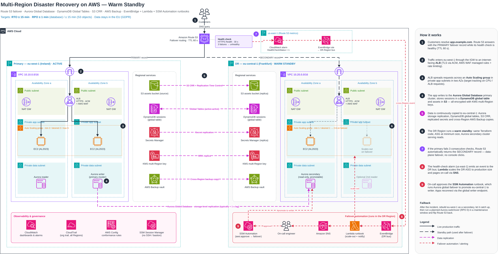

# Multi-Region Disaster Recovery on AWS — Warm Standby

> AWS Solutions Architect – Associate (SAA-C03) graduation project · **Project 5: Multi-Region Disaster Recovery with Route 53 Failover**

A web application runs **active in eu-west-1 (Ireland)** with a **warm standby in eu-central-1 (Frankfurt)**. Route 53 health checks detect a Regional failure and shift DNS automatically; an event-driven runbook scales the standby to production size, and an approval-gated SSM Automation promotes the Aurora Global Database secondary to writer.

| Target | Value | How it is met |
|---|---|---|
| **RTO** (time to restore service) | **≤ 15 min** | Route 53 data-plane failover (~2–3 min) + ASG scale-out (~5 min) + Aurora global failover (minutes) |
| **RPO** – transactional data | **≤ 1 min** | Aurora Global Database storage-level replication (typically < 1 s lag); DynamoDB global tables (typically ~1 s) |
| **RPO** – S3 objects | **≤ 15 min** | S3 Cross-Region Replication with Replication Time Control (15-min SLA) |
| Data residency | EU only | Both Regions are in the EU — relevant for GDPR |

---

## Architecture



> Editable source: [`architecture/multi-region-dr.drawio`](architecture/multi-region-dr.drawio) — open with [app.diagrams.net](https://app.diagrams.net/). The PNG also embeds the diagram, so it can be opened in draw.io directly.

### How it works

| # | Step |
|---|---|
| 1 | Customers resolve `app.example.com`. Route 53 returns the **PRIMARY** failover record while its health check is healthy (TTL 60 s). |
| 2 | Traffic enters eu-west-1 through the Internet Gateway to an internet-facing **Application Load Balancer** (TLS via ACM, AWS WAF managed rules + rate limiting). |
| 3 | The ALB spreads requests across an **Auto Scaling group** of EC2 instances in private app subnets in two AZs (target-tracking scaling). |
| 4 | The app writes to the **Aurora Global Database** primary cluster, stores sessions in a **DynamoDB global table** and assets in **S3** — all encrypted with **KMS multi-Region keys**. |
| 5 | Data is continuously copied to eu-central-1: Aurora storage replication, DynamoDB global tables, S3 CRR, Secrets Manager replica secrets and cross-Region **AWS Backup** copies. |
| 6 | The DR Region runs a **warm standby** built from the same IaC: ASG at minimum size, Aurora secondary cluster serving reads. |
| 7 | If the primary fails 3 consecutive health checks, Route 53 automatically answers with the **SECONDARY** record. This is a data-plane action — no console or API calls needed during the incident. |
| 8 | The `HealthCheckStatus` CloudWatch alarm (Route 53 metrics live in **us-east-1**) emits an event to the DR-Region EventBridge bus; a **Lambda** runbook scales the DR ASG to production size and pages on-call through **SNS**. |
| 9 | On-call approves the **SSM Automation** runbook (`aws:approve`), which runs Aurora `failover-global-cluster` to promote eu-central-1 to writer. The app reconnects through the Aurora **global writer endpoint**. |

**Failback:** rebuild eu-west-1 as a secondary, let it catch up, then run a planned Aurora **switchover** (RPO 0) in a maintenance window and restore the Route 53 primary. See the [runbook](docs/failover-runbook.md).

---

## AWS services used

| Domain | Service | Role in this design |
|---|---|---|
| DNS & routing | **Route 53** | Failover routing policy, health checks, 60 s TTL |
| Networking | **VPC**, IGW, NAT Gateway, Security Groups, NACLs | 3-tier VPC per Region (public / private app / private data), 2 AZs, non-overlapping CIDRs (`10.10.0.0/16`, `10.20.0.0/16`) |
| Load balancing | **ALB** + **ACM** + **AWS WAF** | HTTPS termination, OWASP managed rules, rate-based rule |
| Compute | **EC2** + **Auto Scaling** | Launch template (AL2023, IMDSv2), target tracking; DR min 1 → prod size on failover |
| Relational DB | **Aurora Global Database** | Writer in primary, read-only secondary in DR, global writer endpoint |
| Key-value | **DynamoDB global tables** | Active-active session store — no failover action needed |
| Object storage | **S3** + CRR + RTC | Versioned buckets, replication with 15-min SLA, Block Public Access |
| Backup | **AWS Backup** | Daily plans + cross-Region copy (protects against logical corruption, which replication copies too) |
| Security | **KMS** (multi-Region keys), **Secrets Manager** (replica secrets) | Same key material and secrets available in DR |
| Automation | **CloudWatch**, **EventBridge**, **Lambda**, **SNS**, **SSM Automation** | Detect → scale → notify → approve → promote |
| Operations | **SSM Session Manager**, **CloudTrail**, **AWS Config** | Bastion-free access, audit trail, drift/compliance rules |
| IaC | **Terraform** (one module, two provider aliases) | Identical stacks in both Regions — see [design decisions](docs/design-decisions.md) for the CloudFormation StackSets alternative |

---

## Why Warm Standby?

| Strategy | RTO | RPO | Relative cost | Verdict for this workload |
|---|---|---|---|---|
| Backup & Restore | Hours | Hours (last backup) | $ | RTO too long |
| Pilot Light | 10s of minutes | Seconds–minutes | $$ | Viable, but compute must be provisioned from zero during the incident |
| **Warm Standby** | **Minutes** | **Seconds** | **$$$** | ✅ **Chosen** — scaled-down copy already serving health checks |
| Multi-Site Active/Active | Near zero | Near zero | $$$$ | Needs multi-writer data design; overkill for a 15-min RTO |

Full comparison: [docs/dr-strategies.md](docs/dr-strategies.md).

---

## Repository structure

```
.
├── README.md                    ← you are here
├── architecture/
│   ├── multi-region-dr.drawio   ← editable diagram (AWS 2024 icon set)
│   ├── multi-region-dr.png      ← rendered diagram (draw.io data embedded)
│   └── multi-region-dr.svg      ← vector render
├── evidence/
│   └── README.md                ← naming, redaction & RTO/RPO measurement guide
├── scripts/
│   └── probe.sh                 ← availability probe for measuring RTO
└── docs/
    ├── dr-strategies.md         ← the 4 AWS DR strategies compared
    ├── design-decisions.md      ← architecture decision records (ADRs)
    ├── failover-runbook.md      ← failover & failback procedure
    ├── test-plan.md             ← game-day tests with evidence checklist
    ├── security.md              ← security & compliance controls
    └── cost-estimate.md         ← lab vs production cost model
```

---

## Deployment plan

The infrastructure is defined once and deployed to both Regions.

1. **Prerequisites** — AWS account with IAM Identity Center (no long-lived access keys), Terraform ≥ 1.6, a Route 53 public hosted zone, ACM certificates in **both** Regions.
2. **Foundation (both Regions)** — VPC, subnets, NAT, endpoints, KMS multi-Region key (primary + replica), CloudTrail, Config.
3. **Data layer** — Aurora Global Database (primary in eu-west-1, secondary in eu-central-1), DynamoDB global table, S3 buckets with CRR + RTC, Secrets Manager secret with replica, AWS Backup plan with cross-Region copy.
4. **App layer (both Regions)** — launch template, ASG, ALB, WAF web ACL, target groups.
5. **DNS** — Route 53 health check on `https://<primary-alb>/health`, PRIMARY and SECONDARY failover alias records.
6. **Automation** — CloudWatch alarm in us-east-1, EventBridge cross-Region rule, Lambda runbook, SNS topic, SSM Automation document with `aws:approve`.
7. **Verify** — run the [game-day test plan](docs/test-plan.md), save proof in [`evidence/`](evidence/) and fill in the result log.
8. **Clean up** — `terraform destroy` in both Regions; confirm Aurora, NAT Gateways and Elastic IPs are gone (see [cost estimate](docs/cost-estimate.md)).

---

## Test results

> ⏳ **Not run yet.** The RTO/RPO figures above are design targets. Measured results will be recorded in the [result log](docs/test-plan.md#result-log), with proof in [`evidence/`](evidence/).

| Metric | Target | Measured |
|---|---|---|
| RTO | ≤ 15 min | — |
| RPO (database) | ≤ 1 min | — |
| DNS failover time | ~2–3 min | — |

---

## SAA-C03 exam mapping

| Exam domain | Weight | Where it shows up |
|---|---|---|
| Design Secure Architectures | 30% | Private subnets, SG chaining, WAF, KMS MRKs, Secrets Manager, least-privilege runbook roles, Session Manager |
| Design Resilient Architectures | 26% | Multi-AZ + multi-Region, Route 53 failover, Aurora Global DB, DynamoDB global tables, decoupled automation |
| Design High-Performing Architectures | 24% | ALB + ASG target tracking, Aurora readers, DynamoDB on-demand, regional read locality |
| Design Cost-Optimized Architectures | 20% | Warm standby at minimum size, Aurora Serverless v2 option, S3 lifecycle, lab cost controls |

---

## Lessons learned / trade-offs

- **DNS failover is only as fast as clients honour TTL.** Some resolvers and JVMs cache longer than 60 s; this is why RTO is stated in minutes, not seconds.
- **Replication is not backup.** A bad `DELETE` replicates to DR in under a second — AWS Backup (and Aurora backtrack / PITR) cover logical corruption.
- **Automate the safe parts, gate the risky part.** Scaling compute is idempotent and cheap to undo; promoting a database with `--allow-data-loss` is not, so it requires a human approval.
- **Route 53 health-check metrics only exist in us-east-1**, so the alarm lives there even though the workload does not.

---

## Author

**Alber Ayman** — [github.com/alberayman](https://github.com/alberayman)
